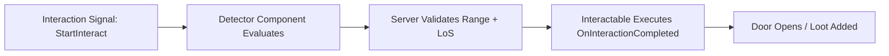

# Gameplay Interaction Framework — Complete User Guide

Welcome to the **Gameplay Interaction Framework** user guide. This document provides step-by-step instructions for designers and programmers to set up, configure, and extend the interaction system in Unreal Engine 5.

---

## Table of Contents

1. [Quick Start: Creating Your First Interactable Object](#1-quick-start-creating-your-first-interactable-object)
2. [Quick Start: Setting Up the Player Character](#2-quick-start-setting-up-the-player-character)
3. [Interaction Modes & Behaviors](#3-interaction-modes--behaviors)
   - [Instant Mode](#instant-mode)
   - [Hold Mode](#hold-mode)
   - [Rapid Tap Mode](#rapid-tap-mode)
   - [Toggle Mode](#toggle-mode)
4. [Using the Blueprint Async Action Node](#4-using-the-blueprint-async-action-node)
5. [Multiplayer Authority & Anti-Cheat](#5-multiplayer-authority--anti-cheat)
   - [Contention Locks](#contention-locks)
   - [Anti-Speedhack Verification](#anti-speedhack-verification)
   - [Disconnect & Crash Recovery](#disconnect--crash-recovery)
   - [3-Phase Async Commit Transactions](#3-phase-async-commit-transactions)
6. [Cross-Level Persistence & Metroidvania Coordination](#6-cross-level-persistence--metroidvania-coordination)
   - [WorldShared vs. InstigatorScoped](#worldshared-vs-instigatorscoped)
   - [World Partition Stream-In Hydration](#world-partition-stream-in-hydration)
   - [Multi-Switch Puzzles Across Levels](#multi-switch-puzzles-across-levels)
7. [Decoupled UI & Interaction Prompts](#7-decoupled-ui--interaction-prompts)
8. [Project Settings & Developer Configuration](#8-project-settings--developer-configuration)
9. [C++ Extension & Custom Trace Strategies](#9-c-extension--custom-trace-strategies)
10. [Troubleshooting & FAQ](#10-troubleshooting--faq)

---

## 1. Quick Start: Creating Your First Interactable Object

Follow these steps to turn any Blueprint Actor into an interactable object (e.g., a door, chest, or terminal):

1. Open your Actor Blueprint (or create a new one derived from `Actor`).
2. In the **Components** panel, click **Add** and search for **Interactable Component** (`UInteractableComponent`).
3. Select the `InteractableComponent` and configure its properties in the **Details** panel:
   - **Interaction Mode Tag**: Select `Interaction.Mode.Instant` (or `Hold`, `RapidTap`, `Toggle`).
   - **Interaction Distance**: Maximum reachable radius in centimeters (default: `250.0`).
   - **Prompt Data**:
     - `ActionText`: Enter text displayed to the player (e.g. `"Open Door"` or `"Search Chest"`).
     - `Subtext`: Optional context (e.g. `"[E] Interact"`).
4. In the Actor's **Event Graph**, select the `InteractableComponent`, right-click, and add event handlers:
   - **On Interaction Completed**: Fired on the authoritative server when interaction succeeds. Connect your gameplay logic here (e.g. play door opening timeline, grant inventory items, unlock door).
   - **On Interaction Started**: Fired when interaction begins.
   - **On Interaction Canceled**: Fired if instigator walks away, cancels, or aborts interaction prematurely.



---

## 2. Quick Start: Setting Up the Player Character

To enable your player (or any instigator) to discover and trigger interactable objects:

1. Open your Player Character Blueprint (derived from `Character` or `Pawn`).
2. In the **Components** panel, click **Add** and select **Interaction Detector Component** (`UInteractionDetectorComponent`).
3. In your Character, Controller, or AI execution graph (e.g. Enhanced Input Action, VR motion grip, mobile touch event, or Behavior Tree):
   - **Interaction Begun / Down / Enter**: Call `StartInteract()` on the `InteractionDetectorComponent`.
   - **Interaction Ended / Up / Exit**: Call `StopInteract()` on the `InteractionDetectorComponent`.
4. (Optional) For rapid tapping / impulse mechanics:
   - Call `TapInteract()` on each pulse or tap event.

```
[ Input Source (Input Action / VR Grip / Mobile Touch / AI) ]
  ├── Begun / Pressed / Squeezed   ──► UInteractionDetectorComponent::StartInteract()
  └── Ended / Released / Released  ──► UInteractionDetectorComponent::StopInteract()
```

---

## 3. Interaction Modes & Behaviors

The framework natively supports 4 distinct interaction modes driven by `Interaction.Mode.*` GameplayTags. The input layer is **fully input-agnostic**—it operates on abstract signals (`StartInteract`, `StopInteract`, `TapInteract`, `ToggleInteract`), making it seamless for Keyboard, Gamepad, VR motion controllers, Mobile touchscreens, and AI bots.

### Instant Mode (`Interaction.Mode.Instant`)
- Executes immediately upon receiving a single `StartInteract()` signal if validation checks pass.
- Ideal for: Pickups, basic doors, buttons, talking to NPCs.
- Server validates range, line-of-sight, and tags before committing.

### Hold Mode (`Interaction.Mode.Hold`)
- Measures continuous engagement time between the `StartInteract()` signal and the `StopInteract()` signal against `HoldDuration` seconds (e.g. 2.0s).
- Dispatches continuous `OnInteractionProgress` events with normalized ratio `(0.0 - 1.0)`.
- If `StopInteract()` is signaled before `HoldDuration` is reached (e.g. VR grip released, touch ended, key released), the interaction cancels with `Interaction.CancelReason.KeyReleased`.
- **Server Authority**: The server measures time elapsed between `Server_StartInteract` and `Server_CompleteHoldInteract` against the player's round-trip ping to prevent speedhacks.
- Ideal for: Reviving teammates, defusing explosives, opening heavy bulkheads, channeled interactions.

### Rapid Tap Mode (`Interaction.Mode.RapidTap`)
- Accumulates progress upon each `TapInteract()` impulse signal.
- Configurable settings on `UInteractableComponent`:
  - `RequiredTapCount`: Number of impulse taps needed to finish (e.g. 10 taps).
  - `TapDecayRate`: Taps per second lost if player pauses tapping (e.g. 1.5 taps/s).
- Ideal for: Breaking free from grabs, prying open jammed crates, physical struggle mechanics.

### Toggle Mode (`Interaction.Mode.Toggle`)
- Switches state between on/off on each `ToggleInteract()` (or `StartInteract()`) signal.
- Tracks `bToggleState` and updates visual cues accordingly.
- Ideal for: Light switches, generator power toggles, valve controls.

---

## 4. Using the Blueprint Async Action Node

For complex gameplay sequences where you want to pause execution until an interaction completes, fails, or reports progress, use the **`Perform Interaction Async`** latent node:

1. In any Blueprint graph, right-click and search for **Perform Interaction Async**.
2. Supply the **Target Object** (Actor or Component implementing `IInteractableTarget`) and **Instigator Actor**.
3. Handle the execution pins:
   - **On Started**: Fires when client initiates interaction and requests server validation.
   - **On Progress**: Fires continuously during Hold or RapidTap interactions, providing `ProgressRatio (0.0 - 1.0)`.
   - **On Completed**: Fires when server commits completion.
   - **On Failed**: Fires if rejected by server (e.g. target busy, out of range, missing keycard). Inspect `FailureReasonTag` for specific feedback.

```
                  ┌─────────────────────────────────────────┐
                  │        Perform Interaction Async        │
 (Exec) ─────────►│ InExec                        OnStarted ├─────► [Play Start Sound]
 (Target) ───────►│ TargetObject                 OnProgress ├─────► [Update Circular Bar]
 (Instigator) ───►│ InstigatorActor              OnCompleted├─────► [Open Chest UI]
                  │                                OnFailed ├─────► [Show "Keycard Missing"]
                  └─────────────────────────────────────────┘
```

---

## 5. Multiplayer Authority & Anti-Cheat

`GameplayInteractionFramework` is built from the ground up for authoritative dedicated and listen servers.

### Contention Locks
By default, `bAllowConcurrentInteractions` is `false`. When Player A begins interacting with an object, the server claims an atomic lock. If Player B attempts to interact simultaneously:
- The server rejects Player B with `EInteractionValidationResult::TargetBusy` (`Interaction.CancelReason.TargetBusy`).
- Player B receives a client notification without causing state desynchronization.

### Anti-Speedhack Verification
Malicious clients modifying local time or spamming RPCs cannot bypass hold durations.
- The server tracks the start timestamp using authoritative world time.
- Upon receiving completion request, the server calculates:
  $$\Delta t = t_{\text{current}} - t_{\text{start}}$$
- If $\Delta t < (\text{HoldDuration} - \text{LatencyTolerance})$, the server rejects the interaction with `Interaction.CancelReason.TimingViolation`.

### Disconnect & Crash Recovery
If a client crashes, disconnects, or closes the game while holding a locked interaction:
- The `UInteractableComponent` automatically detects the instigator's destruction through `CurrentHoldInstigator->OnEndPlay`.
- The lock is instantly released and reverted to `Interaction.State.Available`.
- A fallback **Lease Timer** (`InteractionLeaseDuration`) ensures that even if a client freezes without disconnecting, abandoned locks expire automatically.

### 3-Phase Async Commit Transactions
For interactions involving asynchronous backend systems (e.g. saving player inventory to database, querying an external microservice):
1. Call `BeginAsyncInteraction(Context)`: Target enters `Interaction.State.PendingCommit`. Contention lock remains held; other players cannot tamper with the object.
2. Complete backend async query.
3. If successful: Call `CommitAsyncInteraction(TransactionId)`.
4. If failed or timed out: Call `RollbackAsyncInteraction(TransactionId, ReasonTag)` to safely revert state.

---

## 6. Cross-Level Persistence & Metroidvania Coordination

In large-world games, Metroidvania adventures, or streaming World Partition maps, interactable objects unload and reload as players move.

### WorldShared vs. InstigatorScoped
Assign the persistence mode in `UInteractableComponent`:
- **`WorldShared`**: Universal world changes (e.g. lowering a drawbridge, draining poison water, unlocking shortcut doors). Once completed by any player, the state remains completed for all players across all streamed cells.
- **`InstigatorScoped`**: Per-player personal progression (e.g. personal loot chests, collectible audio logs, NPC dialogue completion). Each player maintains an independent ledger entry.

### World Partition Stream-In Hydration
When a cell streams into memory:
1. `UInteractableComponent::BeginPlay()` checks if `PersistentStateTag` is set.
2. It queries `UInteractionPersistenceSubsystem` on the `GameInstance`.
3. If already marked `Completed`, the component immediately initializes to `Completed` without firing duplicate completion audio, animation timelines, or network RPCs.

### Multi-Switch Puzzles Across Levels
To create puzzles requiring multiple switches across different maps (e.g., 4 players activating 4 terminals across 4 separate levels to unlock a central vault in Level 4):
```cpp
// Check if 4 required tags were activated within a 60-second window:
TArray<FGameplayTag> RequiredSwitches = { Tag_Switch1, Tag_Switch2, Tag_Switch3, Tag_Switch4 };
bool bPuzzleSolved = PersistenceSubsystem->CheckMultiSwitchRequirements(RequiredSwitches, 60.0f);
```

---

## 7. Decoupled UI & Interaction Prompts

The framework separates UI rendering from gameplay logic via `UInteractionLocalPlayerSubsystem`:

1. Create a Widget Blueprint derived from `UInteractionPromptWidgetBase`.
2. In your HUD or Screen layout, add this widget.
3. Override Blueprint events:
   - **On Prompt Target Changed**: Receives new `FInteractionPromptData` (ActionText, Subtext, Icon). Animate prompt fade-in/fade-out here.
   - **On Progress Updated**: Receives current progress `(0.0 - 1.0)`. Update radial progress bars or fill animations here.
4. The local player subsystem automatically listens to the primary `UInteractionDetectorComponent` and updates the UI with zero polling.

---

## 8. Project Settings & Developer Configuration

Navigate to **Project Settings -> Game -> Gameplay Interaction Framework** to configure global defaults:

| Setting | Default Value | Description |
| :--- | :--- | :--- |
| `DefaultTraceChannel` | `ECC_Visibility` | Collision trace channel for raycasts and sweeps |
| `DefaultTraceStrategyClass` | `CameraLineTrace` | Trace strategy used when not overridden per component |
| `CandidateQueryInterval` | `0.0333 s` (30 Hz) | Broad-phase detection throttling to save CPU cycles |
| `DefaultMaxInteractionDistance` | `300.0 cm` | Fallback interaction distance |
| `NetworkHoldTimeTolerance` | `0.15 s` | Allowed latency jitter for server hold validation |
| `NetworkDistanceTolerance` | `50.0 cm` | Allowed distance discrepancy between client and server |

### Console Debug Commands
- `Interact.Debug 1`: Displays on-screen debug canvas showing candidate scores, primary nominated target, and interaction state.
- `Interact.DrawTraces 1`: Renders line traces and hit spheres in the viewport with color coding (Green = Hit, Red = Miss, Blue = Occluded).

---

## 9. C++ Extension & Custom Trace Strategies

### Custom Trace Strategy
To implement a custom raycast algorithm (e.g. VR hand motion controller pointing or mouse cursor screen-to-world raycasting):

1. Create a C++ class implementing `IInteractionTraceStrategy`:
```cpp
UCLASS()
class UMyVRHandTraceStrategy : public UObject, public IInteractionTraceStrategy
{
    GENERATED_BODY()
public:
    virtual bool ExecuteTrace_Implementation(
        const AActor* InstigatorActor,
        const FVector& ViewLocation,
        const FVector& ViewDirection,
        float MaxDistance,
        TArray<FHitResult>& OutHits) override
    {
        // Custom hand raycast logic here
        return OutHits.Num() > 0;
    }
};
```
2. Assign the strategy in `UInteractionDetectorComponent::CustomTraceStrategy` or project settings.

---

## 10. Animation Synchronization (AnimNotify & AnimNotifyState)

`GameplayInteractionFramework` provides tag-driven animation integration with **zero hardcoded animation assets**:
- **`UAnimNotify_InteractionEvent`**: Place on an exact animation keyframe (e.g. hand contacts lever, key turns in lock). Set `EventTag` to `Interaction.Event.Commit`, `Interaction.Event.Cancel`, or any custom gameplay tag.
- **`UAnimNotifyState_InteractionEvent`**: Place across a continuous window on an AnimMontage (e.g. picking a lock, channeling a shrine). Set `BeginEventTag` (e.g. `Interaction.Event.Start`), `EndEventTag` (e.g. `Interaction.Event.Commit`), and `InterruptedReasonTag` (e.g. `Interaction.CancelReason.MontageInterrupted`). If the character takes damage or rolls, montage interruption automatically cancels the interaction.
- **Designer Freedom**: Designers retain 100% control over how animations are played, blended, or streamed (GAS, StateTree, Motion Matching, or Blueprint Play Montage).

---

## 11. Troubleshooting & FAQ

#### Q: The interaction prompt doesn't appear when looking at an object.
- **Check Collision**: Ensure the object's mesh or collision primitive blocks `ECC_Visibility` (or your configured trace channel).
- **Check Distance**: Ensure the actor is within `InteractionDistance` (default 250 cm).
- **Check Facing Angle**: Directional scoring penalizes targets behind the player. Ensure the player's view vector faces the target.
- **Run Console Command**: Enter `Interact.DrawTraces 1` in the console to visually inspect raycast hits.

#### Q: The interaction is immediately rejected with `MissingRequiredTags`.
- Check `RequiredInstigatorTags` on the `UInteractableComponent`. If configured, the instigating Actor must possess matching GameplayTags on its `IInteractionInstigator` interface or `AbilitySystemComponent`.

#### Q: How do I change the hold duration dynamically in runtime?
- Call `SetHoldDuration(float NewDuration)` on `UInteractableComponent` on the authoritative server.

---

For further technical details, see the architecture documents in [`README.md`](README.md).
